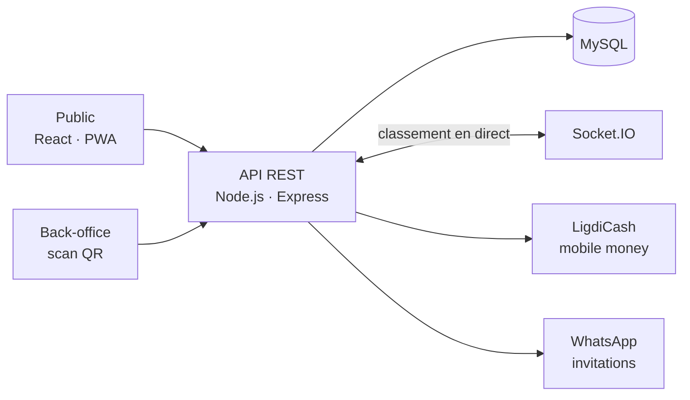

# DOLO Koura — vote en ligne pour un concours de chant

**Site :** [dolokoura.com](https://dolokoura.com) · **Rôle :** conception, développement full stack, déploiement

DOLO Koura est un concours de chant au Mali. La plateforme permet au public de voter pour ses candidats en payant par mobile money, et affiche le classement en temps réel.

## Fonctionnalités

- **Vote payant** par mobile money, via l'agrégateur de paiement **LigdiCash** (retour de paiement, annulation, confirmation).
- **Classement en temps réel** grâce à Socket.IO.
- **Candidats et nominés** par semaine, artistes invités, logos des partenaires.
- **Partage** des pages candidats sur les réseaux sociaux.
- **Cartes d'invitation** générées automatiquement avec QR code, envoi par WhatsApp, contrôle à l'entrée par scan du QR code.
- **Back-office** installable (PWA) : candidats, semaines de nomination, statistiques, exports Excel.

## Architecture

## Technologies

| Couche | Technologies |
|---|---|
| Front-end | React, Vite, Tailwind CSS, Framer Motion, ZXing (lecture de QR code) |
| API | Node.js, Express, Sequelize, JWT, Joi, Helmet, Socket.IO |
| Paiement | LigdiCash (mobile money) |
| Génération | Cartes d'invitation (Sharp, QR codes, archives ZIP), whatsapp-web.js |
| Données | MySQL |

---

[← Retour au portfolio](../README.md) · Code source privé, démonstration sur demande.
