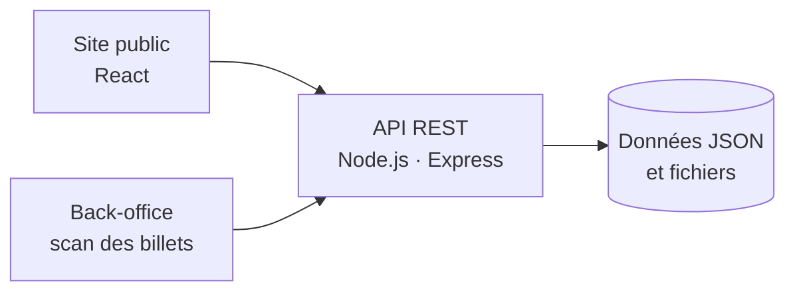

# Forum — site officiel d'un événement

**Rôle :** conception, développement full stack

Site officiel d'un forum professionnel : présentation de l'événement, actualités, inscription en ligne et billet électronique contrôlé à l'entrée.

## Fonctionnalités

- **Site public** : programme, intervenants, actualités, formulaire de contact.
- **Inscription en ligne**, validée ou refusée depuis le back-office.
- **Billet électronique** avec QR code, contrôlé à l'entrée par scan.
- **Annuaire des exposants et partenaires**, avec cartes de visite (vCard) téléchargeables.
- **Back-office** : contenus du site, inscriptions, messages, paramètres, statistiques.

## Architecture

## Technologies

| Couche | Technologies |
|---|---|
| Front-end | React, Vite, Tailwind CSS, Framer Motion, QR codes |
| API | Node.js, Express, JWT, Helmet, Multer, limitation du nombre de requêtes |

---

[← Retour au portfolio](../README.md) · Code source privé, démonstration sur demande.
