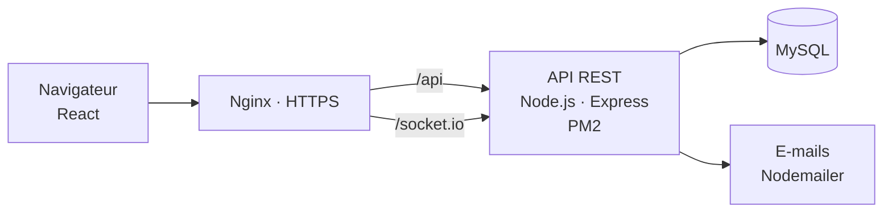

# Gestion des dépenses — application d'entreprise

**Site :** [app.somajeux.ml](https://app.somajeux.ml/) (accès réservé aux employés de l'entreprise) · **Rôle :** conception, développement full stack, déploiement

Cette application remplace le suivi des dépenses sur tableur. Les employés soumettent leurs demandes, les responsables les valident, et la direction suit les budgets en temps réel.

## Fonctionnalités

- **Demandes de dépenses** avec validation en plusieurs étapes (ou refus motivé) et historique.
- **Dépenses** : catégories, centres de coût, projets, fournisseurs, agences.
- **Budgets** et tableaux de bord (dépenses, demandes).
- **Rapports** PDF et Excel, import CSV.
- **Utilisateurs** : invitations, rôles et permissions, connexion avec code de vérification (OTP), réinitialisation du mot de passe.
- **Notifications en temps réel** (Socket.IO).
- **Journal d'activité** et corbeille.

## Architecture

## Technologies

| Couche | Technologies |
|---|---|
| Front-end | React, Vite, Tailwind CSS, TanStack Table, React Hook Form, jsPDF |
| API | Node.js, Express, Sequelize, JWT, Helmet, Socket.IO, Nodemailer |
| Documents | PDFKit, ExcelJS, QR codes |
| Données | MySQL |
| Déploiement | VPS, CloudPanel, Nginx, PM2, Docker Compose |

---

[← Retour au portfolio](../README.md) · Code source privé, démonstration sur demande.
