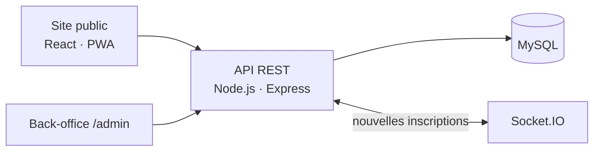
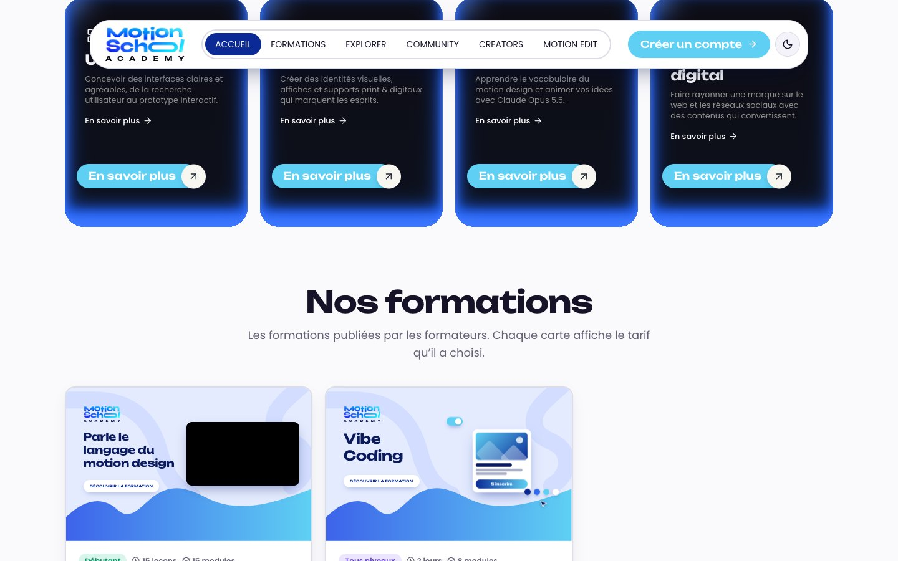

# Motion School Academy — site et back-office d'une académie

**Site :** [motionschoolacademy.com](https://motionschoolacademy.com/) · **Rôle :** conception, développement full stack

**Maquettes Figma :** [ouvrir dans Figma](https://www.figma.com/design/8nEDd93grqnVLf4OM3cpHF) (accueil ordinateur et mobile)

Site public d'une académie de formation en motion design (After Effects, 2D et 3D), avec un back-office pour gérer les formations et suivre les inscriptions.

**Expérience utilisateur :** un site animé, à l'image du motion design, qui reste léger et installable sur téléphone. L'inscription se fait en quelques étapes.

## Fonctionnalités

- **Site public** : présentation des formations, tarifs, sessions, FAQ, formulaire d'inscription.
- **Tableau de bord** : inscriptions des 30 derniers jours, suivi par formation et par statut, prochaines sessions.
- **Inscriptions** : liste filtrable, statut, notes internes, **export Excel et CSV**.
- **Notification en temps réel** à chaque nouvelle inscription (Socket.IO).
- **Formations et cours** : contenus, niveaux, tarifs.
- **Comptes membres** et profil administrateur.
- Application installable (PWA).

## Architecture

## Technologies

| Couche | Technologies |
|---|---|
| Front-end | React 19, Vite, Tailwind CSS 4, Framer Motion, vite-plugin-pwa |
| API | Node.js, Express, Sequelize, JWT, Socket.IO, Nodemailer |
| Données | MySQL |
| Tests | Vitest |

## Captures du site

| Formations | Réalisations des apprenants | Mobile |
|---|---|---|
|  |  |  |

---

[← Retour au portfolio](../README.md) · Code source privé, démonstration sur demande.
