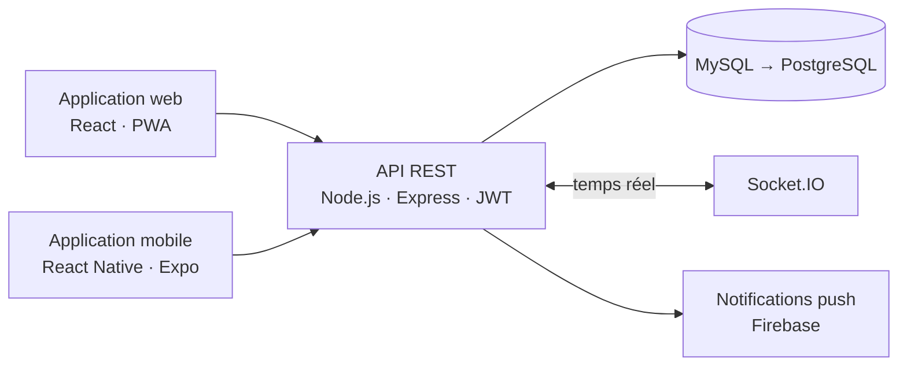
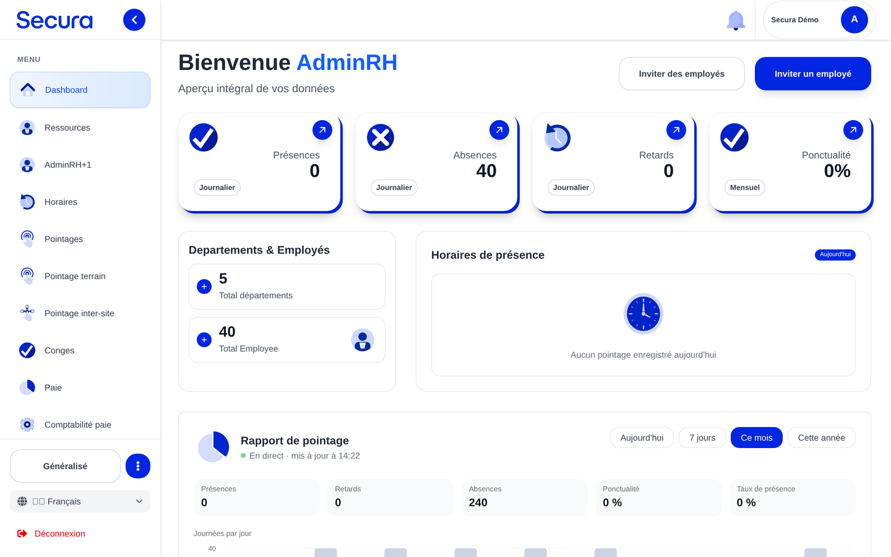
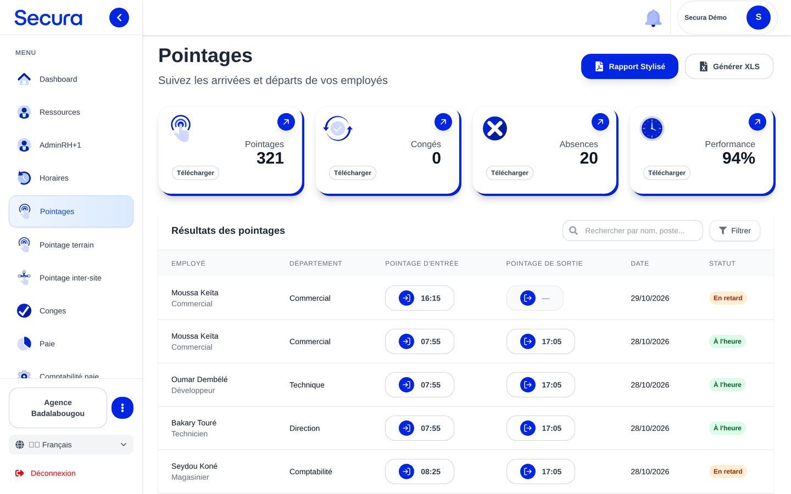
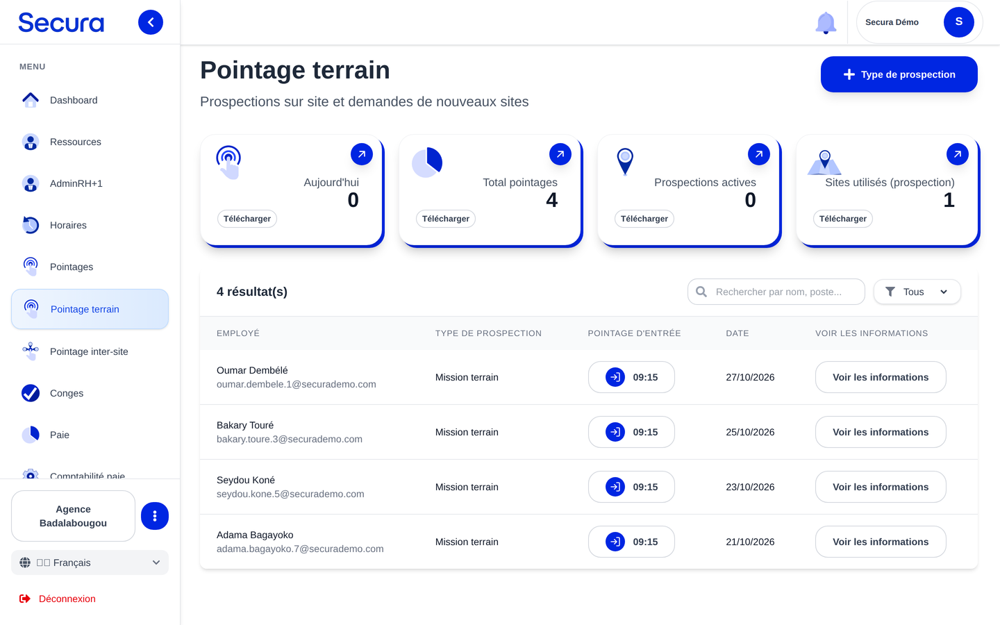
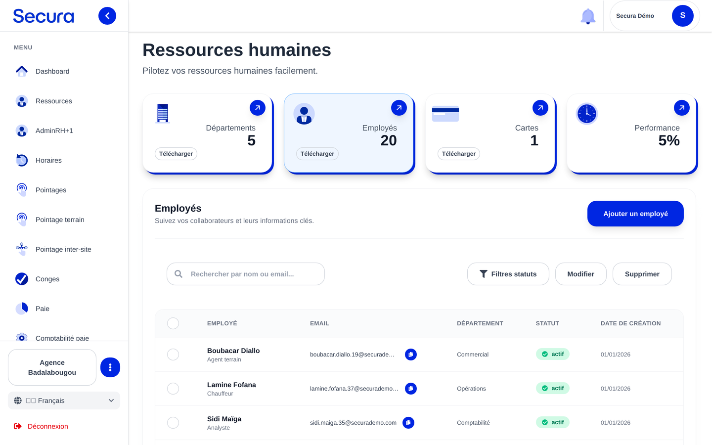
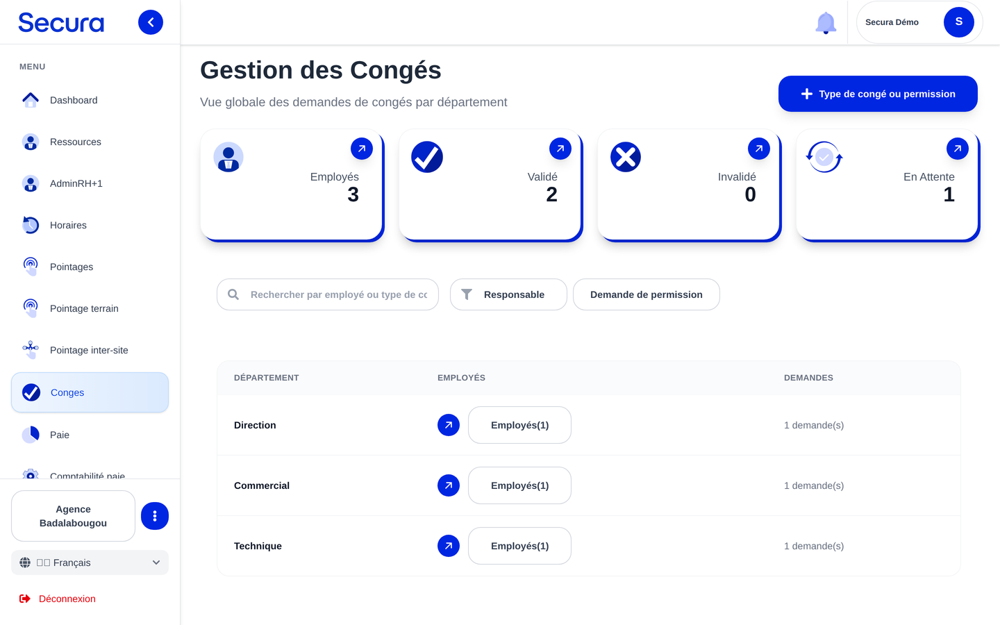
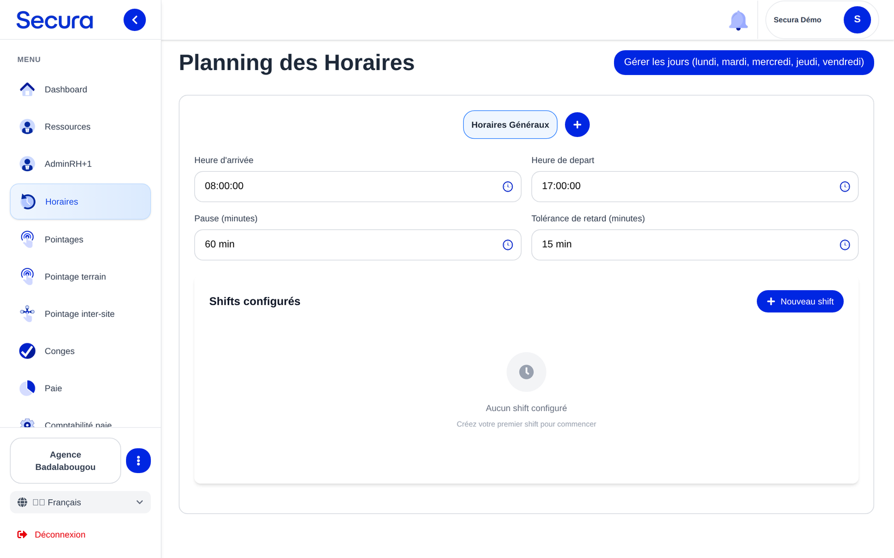

# Secura — pointage sécurisé et suivi RH

**Site :** [app-secura.com](https://app-secura.com) · **Cadre :** Startup SecureTech CORPORATE · **Rôle :** conception UX/UI, développement full stack, déploiement

Secura permet à une entreprise de suivre la présence de ses équipes en temps réel : pointage au bureau, sur le terrain ou entre plusieurs sites, horaires, retards, congés et paie. Elle existe en application web installable et en application mobile.

## Fonctionnalités

- **Tableau de bord RH** : présences, absences, retards et ponctualité du jour, du mois ou de l'année.
- **Ressources humaines** : départements, fiches employés, invitations, cartes.
- **Horaires** : horaires généraux, pauses, tolérance de retard, shifts.
- **Pointages** : arrivées et départs avec statut (à l'heure, en retard), rapports PDF et Excel.
- **Pointage terrain et inter-site** : missions et déplacements entre sites, avec durée.
- **Congés et permissions** : demandes, validation par département.
- **Paie** et comptabilité de la paie.
- **Abonnements** : plusieurs entreprises clientes sur la même plateforme.
- **Sécurité** : connexion par passkey (WebAuthn, biométrie), JWT.
- Interface multilingue.

**Application mobile (React Native / Expo)** : pointage géolocalisé, authentification biométrique, notifications push, connexion à la même API.

## Architecture

## Technologies

| Couche | Technologies |
|---|---|
| Web | React, MUI, TanStack Query, i18next, Leaflet (cartes), jsPDF |
| Mobile | React Native, Expo (géolocalisation, biométrie, notifications, stockage sécurisé) |
| API | Node.js, Express, Sequelize, JWT, WebAuthn (SimpleWebAuthn), Socket.IO, Multer |
| Données | MySQL, migration vers PostgreSQL |
| Déploiement | VPS Ubuntu, environnements de test et de production |

## Captures (compte de démonstration)

| Tableau de bord | Pointages |
|---|---|
|  |  |
| **Pointage terrain** | **Employés** |
|  |  |
| **Congés** | **Horaires** |
|  |  |

---

[← Retour au portfolio](../README.md) · Code source privé, démonstration sur demande.
