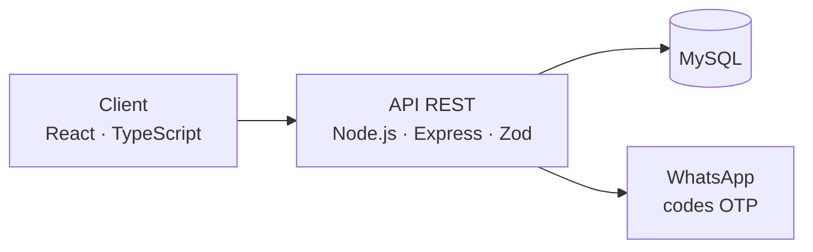

# Tontineo — gestion de tontine

**Code source public :** [github.com/Tondiness/Fintech-IAM](https://github.com/Tondiness/Fintech-IAM) · **Cadre :** projet du Master spécialisé, IAM Bamako (2026)

**Maquettes Figma :** [ouvrir dans Figma](https://www.figma.com/design/g0fx85kA0p1UG00yQOgLnq) (connexion des trois espaces)

Application de tontine digitalisée : les agents enregistrent les dépôts et les retraits des clients, cycle par cycle, et l'administration suit tous les mouvements financiers. Le projet a suivi une démarche « spécification d'abord » : règles métier, modèle de données et tests sont documentés.

**Expérience utilisateur :** connexion par numéro de téléphone et code reçu sur WhatsApp, adaptée aux habitudes des clients de tontine.

## Fonctionnalités

- **Trois espaces** : administrateur, agent, client.
- **Clients et agents**, cycles de tontine.
- **Dépôts, retraits** et historique des mouvements financiers.
- **Inscription des clients avec code OTP envoyé par WhatsApp**.
- Connexion par numéro de téléphone.

## Architecture

## Technologies

| Couche | Technologies |
|---|---|
| Front-end | React 18, TypeScript, Vite, shadcn/ui, Tailwind CSS 4, TanStack Query, Zustand |
| API | Node.js, Express, Sequelize, JWT, bcrypt, Zod |
| Données | MySQL |
| Tests | Jest, Supertest |
| Documentation | architecture, modèle de données, règles métier, traçabilité, rapport de tests |

---

[← Retour au portfolio](../README.md)
