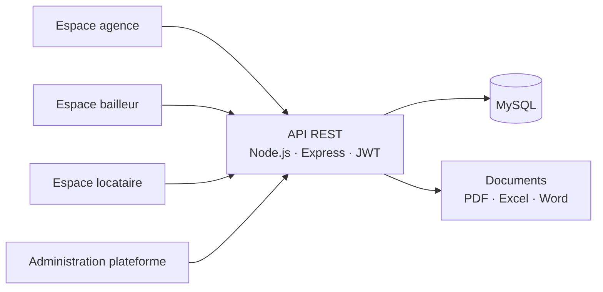
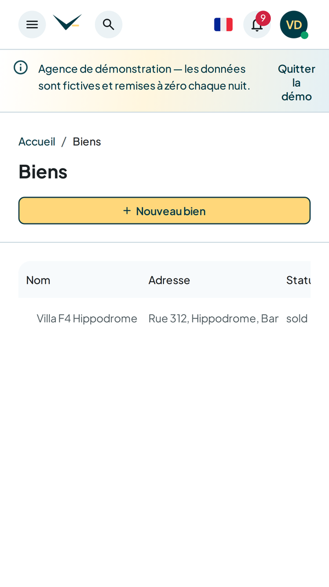
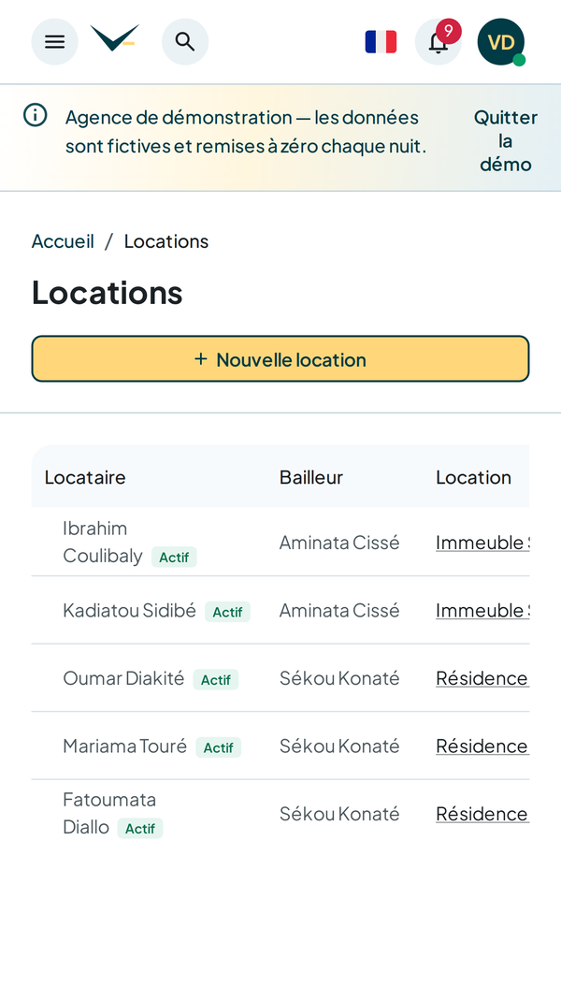
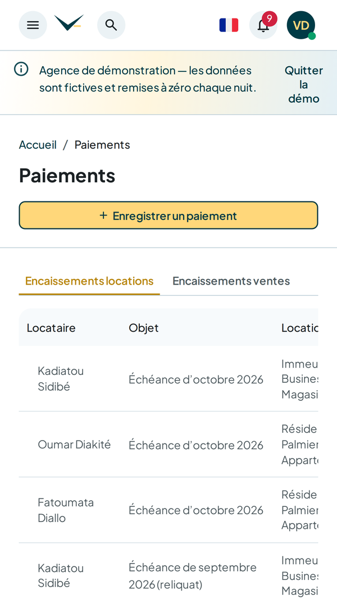
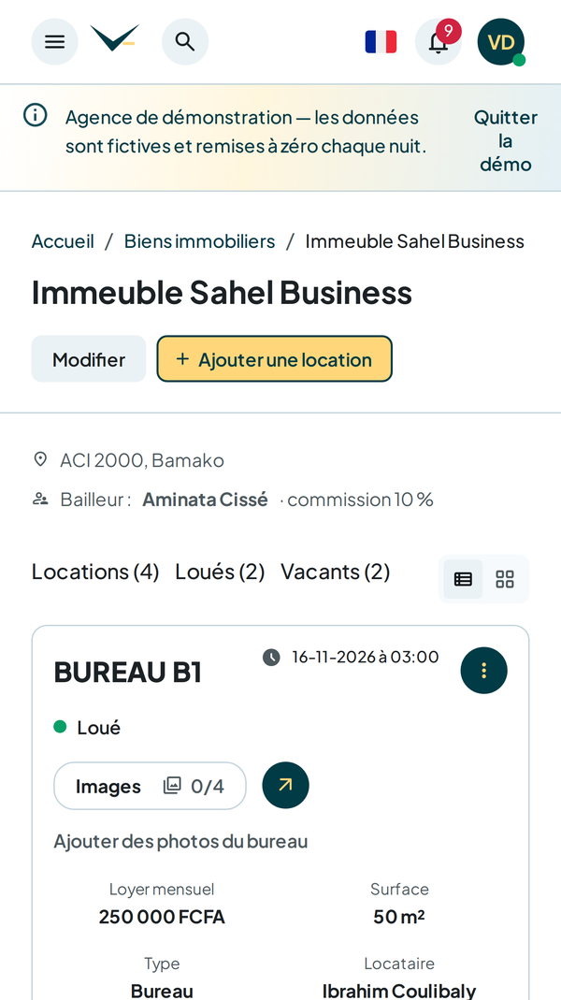

# V-Immo — gestion immobilière pour agences

**Site :** [v-immo.ml](https://v-immo.ml) (agence de démonstration accessible sans compte) · **Rôle :** conception, développement full stack

V-Immo est un SaaS pour les agences immobilières : gestion des biens, des bailleurs et des locataires, encaissement des loyers et suivi des impayés. Chaque agence a son espace, et ses bailleurs et locataires ont aussi le leur.

## Fonctionnalités

- **Quatre espaces** : administrateur de la plateforme, agence, bailleur, locataire.
- **Biens** : immeubles, lots, logements, états des lieux, maintenance.
- **Tiers** : locataires, acquéreurs, propriétaires, avec leurs contrats.
- **Locations** : contrats de location et contrats de gestion (mandats).
- **Encaissements** : loyers, cautions, frais ; **quittances PDF** ; suivi des **impayés**.
- **Paiement déclaré par le locataire** depuis son espace, puis validé par l'agence.
- **Portefeuille du bailleur** : revenu net (encaissé − commission − dépenses).
- **Ventes**, dépenses, documents, tâches, rapports et **exports Excel**.
- **Agence de démonstration** aux données fictives, remise à zéro chaque nuit.

## Architecture

## Technologies

| Couche | Technologies |
|---|---|
| Front-end | React, TypeScript, MUI, ECharts, Vite |
| API | Node.js, Express, Sequelize, JWT, Helmet, limitation des tentatives de connexion |
| Documents | PDFKit, ExcelJS, Docxtemplater, QR codes |
| Données | MySQL |

## Captures (agence de démonstration, vue mobile)

| Accueil | Tableau de bord | Biens |
|---|---|---|
|  |  |  |
| **Locations** | **Encaissements** | **Fiche immeuble** |
|  |  |  |

---

[← Retour au portfolio](../README.md) · Code source privé, démonstration sur demande.
