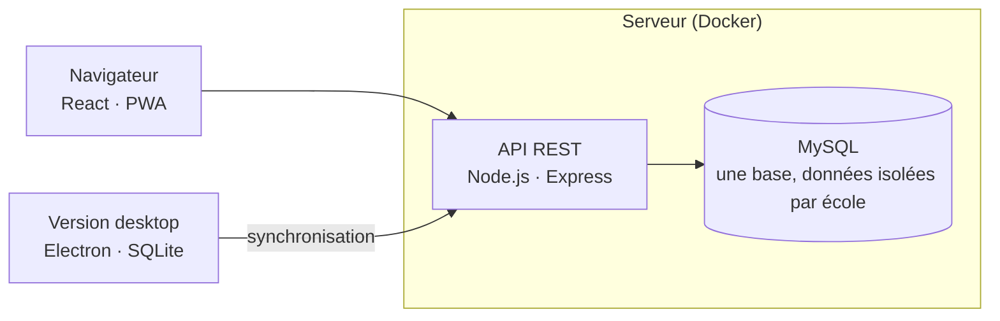
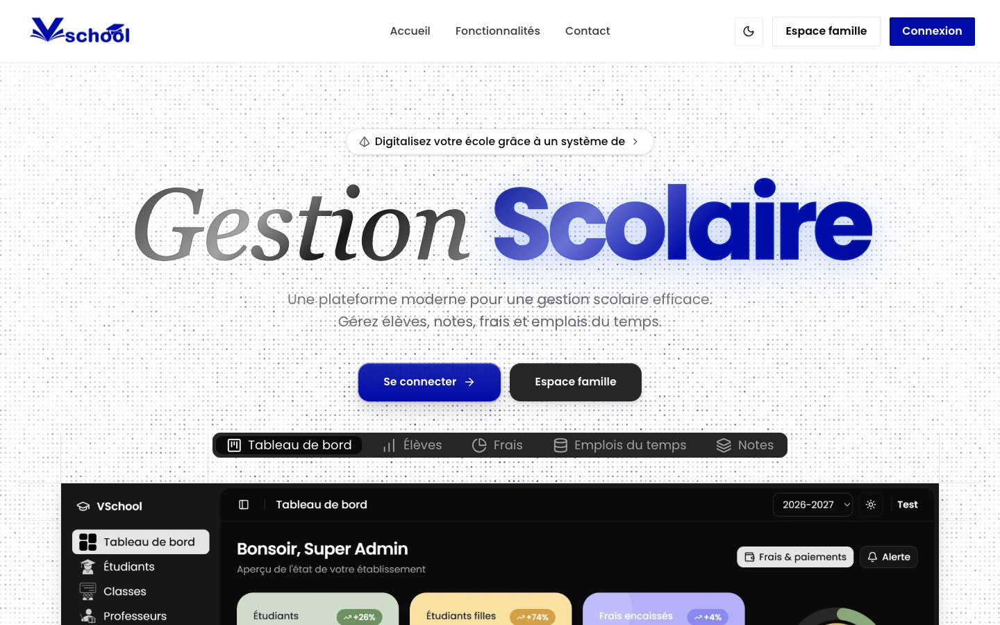
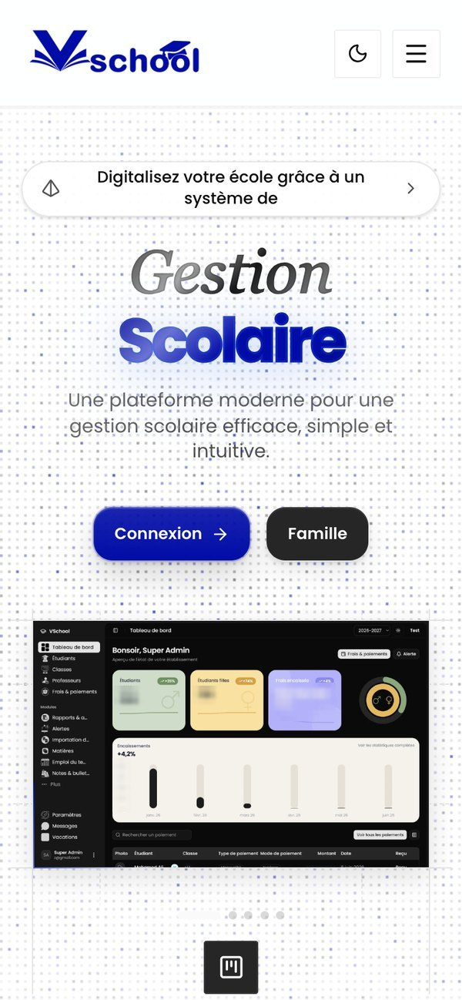
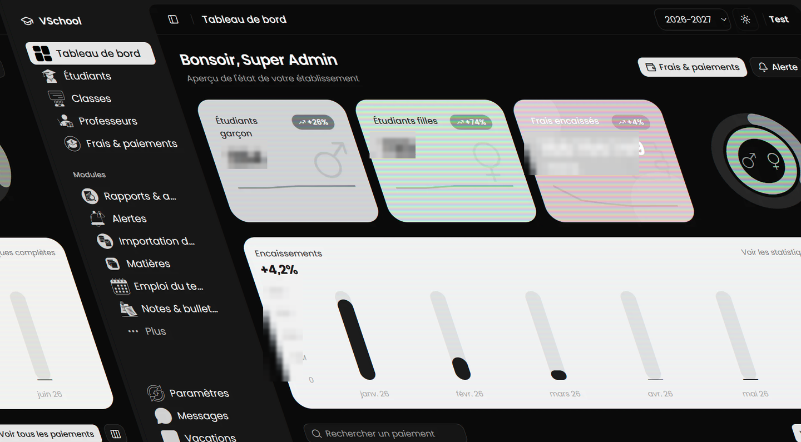

# V-School — logiciel de gestion scolaire

**Site :** [v-school.fr](https://v-school.fr) · **Rôle :** conception, développement full stack, déploiement

**Maquettes Figma :** [ouvrir dans Figma](https://www.figma.com/design/jOtGdZPSyIfQlu4xCMBHBc) (37 écrans : connexion, tableau de bord, étudiants et profil, paiement, notes et bulletins, emplois du temps, classes, professeurs, finances, modules et paramètres ; établissement de démonstration, données remplacées par des données fictives)

V-School rassemble la vie d'un établissement scolaire dans un seul outil : élèves, caisse, notes, bulletins, documents officiels et emplois du temps. Une même plateforme sert plusieurs écoles, chacune avec ses propres données.

**Expérience utilisateur :** chaque rôle (direction, secrétariat, comptabilité, professeurs, familles) ne voit que ce qui le concerne. Avec la version desktop, l'école continue de travailler même sans Internet.

## Fonctionnalités

- **Élèves et classes** : annuaire, photo, matricule, parent, import Excel.
- **Frais et paiements** : barème, encaissement, reçu, créances. Modes : espèces, Mobile Money, virement, chèque.
- **Notes et bulletins**, emplois du temps, présences.
- **Documents officiels numérotés**, avec QR code de vérification en ligne, signature et cachet de l'école.
- **Professeurs** : matières, vacations.
- **Messagerie** interne et alertes.
- **Un accès par rôle** : direction, secrétariat, comptabilité, professeurs, familles.
- **Deux niveaux d'administration** : la plateforme crée les écoles, chaque école gère ses données.
- **Version desktop** (Electron) qui fonctionne hors ligne, puis se synchronise avec le serveur.

## Architecture

## Technologies

| Couche | Technologies |
|---|---|
| Front-end | React, Vite |
| API | Node.js 20 (ES modules), Express, Sequelize, JWT |
| Données | MySQL, isolation des données par établissement |
| Desktop | Electron, serveur Express embarqué, SQLite, mises à jour automatiques |
| Déploiement | Docker, Nginx |

## Captures

| Site (ordinateur) | Mobile |
|---|---|
|  |  |

**Tableau de bord de la direction**

Sur les captures, les chiffres de l'établissement sont floutés.

---

[← Retour au portfolio](../README.md) · Code source privé, démonstration sur demande.
